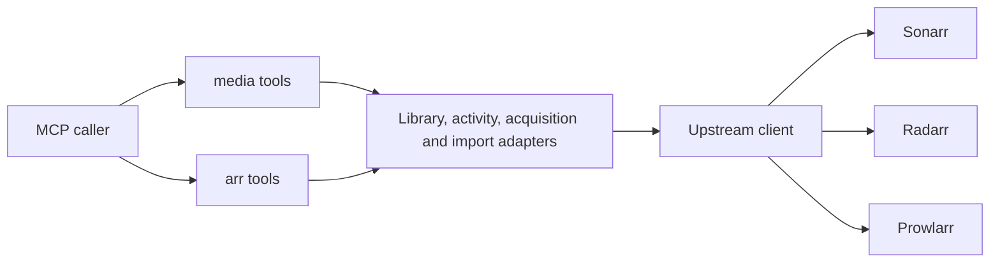

# Media Toolset

## Overview

This specification defines the `media` toolset: the smallest set of tools that manages a media library across the supported applications, talking about movies, TV series, and downloads rather than about Sonarr, Radarr, and Prowlarr. Inputs and results carry only what a caller needs for its next step. A caller finds a title, adds it, asks how it is going, and asks for a stuck download to be fixed. The server decides which application handles the request, which quality profile and root folder to use, and which upstream steps to run. Which toolset a process publishes, and the conventions every published tool shares, are owned by [Tool Contracts](../tool-contracts/).

**Status:** partially implemented. [0031-media-toolset-library](../../changes/0031-media-toolset-library.md) implemented `media_find` and `media_add` with the identity, footprint, and default rules they need, published when `ARR_MCP_TOOLSET` selects `media`. [0032-media-toolset-activity](../../changes/0032-media-toolset-activity.md) implemented `media_status`, `media_fix`, `media_search_again`, and `media_remove`, which is published only where `ARR_MCP_MEDIA_ALLOW_REMOVE` is `true`, so the toolset offers no tool that refuses unconditionally; its fixture captures C1 to C3 are still pending. `arr` stays the default toolset until [0033-media-default-toolset](../../changes/0033-media-default-toolset.md) makes this one the default.

## Background

The `arr` toolset exposes the applications' own model: application names, quality profile and root folder references, queue item kinds, plan and apply, and fourteen tools whose inputs presuppose knowing how the three applications divide the work. That suits an operator who knows them. It costs everyone else several calls and several decisions before anything happens: to add a show, a caller looks it up, observes quality profiles, observes root folders, plans the add, and applies the plan.

Most requests are simpler than that model: get this movie, how is that show doing, why is this stuck. The `media` toolset serves those requests and leaves the full model to the `arr` toolset.

The toolset is built on the same adapters, upstream client, and error contract as the `arr` toolset. It changes what a caller has to know, not how the server talks to the applications.

Related behavior:

- [Tool Contracts](../tool-contracts/) owns toolset selection, published schema rules, bounded results, and the error contract.
- [Library Management](../library-management/), [Activity Management](../activity-management/), and [Acquisition and Import](../acquisition-and-import/) own the `arr` toolset's behavior over the same upstream records.
- [Architecture](../architecture/) owns environment-only configuration and the testing contract.

## Requirements

### Published Tools

- The `media` toolset MUST publish `media_find`, `media_add`, `media_status`, `media_fix`, and `media_search_again`.
- The `media` toolset MUST publish `media_remove` if and only if `ARR_MCP_MEDIA_ALLOW_REMOVE` is `true`.
- A `media` tool's name, title, description, input properties, and result fields MUST NOT name Sonarr, Radarr, Prowlarr, or any of their concepts that a caller would have to understand to use the tool: application, quality profile, root folder, indexer, download client, tag, command, plan, or opaque reference.
- Text an upstream application wrote MAY be carried in a result only as explanatory detail, never as a value a caller must interpret to choose its next call.
- A `media` tool MUST NOT accept a plan reference, a mode, or any other two-step confirmation input; every call acts on its own and its result MUST state what it did.

#### Scenario: List the media toolset

- **GIVEN** the `media` toolset is selected and `ARR_MCP_MEDIA_ALLOW_REMOVE` is absent
- **WHEN** a caller lists tools
- **THEN** exactly `media_find`, `media_add`, `media_status`, `media_fix`, and `media_search_again` are published, and none of their schemas or descriptions names an *arr application

### Minimal Footprint

The toolset exists to be the smallest surface that manages a library across the supported applications. Every input and result field below is there because a caller needs it to take the next step; anything a caller could do without is left out.

- A `media` tool MUST accept only the inputs this specification names for it, and its result MUST carry only the fields this specification names for it plus the shared errors and warnings.
- A `media` tool MUST NOT offer detail levels, projections, paging, or continuation; every list it returns is bounded by this specification instead.
- A `media` tool's text summary MUST be a single line.
- The complete `tools/list` response for the `media` toolset, with `media_remove` published, MUST be at most 12 000 bytes.

#### Scenario: The whole toolset is cheap to list

- **GIVEN** the `media` toolset is selected and removal is enabled
- **WHEN** a caller lists tools
- **THEN** the response is at most 12 000 bytes, and every input property it publishes is one this specification names

### Media Identity

- A movie MUST be identified by `kind: "movie"` and its TMDB id, and a series by `kind: "series"` and its TVDB id.
- Every `media` tool that acts on a title MUST accept that pair as its only identification of the title.
- Every title a `media` tool returns MUST carry its kind and id, so any result can be passed to any other `media` tool without translation.
- A `media` tool MUST NOT require a value that an earlier call minted, and an id MUST remain valid across server restarts.
- A kind whose application is not configured MUST be refused with `unconfigured_application` and a remediation naming the kind rather than the application.

#### Scenario: Identity survives a restart

- **GIVEN** a caller found a series and received its kind and id
- **WHEN** the server restarts and the caller passes that pair to `media_status`
- **THEN** the series' status is returned, with no stale-reference error

#### Scenario: Ask for a kind the deployment does not serve

- **GIVEN** only movies are served by this deployment
- **WHEN** a caller adds a series
- **THEN** the call fails with `unconfigured_application`, and the remediation says TV series are not available here without naming an application

### Deployment Defaults

- The quality profile and root folder used for a new title MUST come from these environment variables, read once at startup:

  | Variable | Meaning |
  |---|---|
  | `ARR_MCP_MEDIA_MOVIE_QUALITY_PROFILE` | Quality profile name for new movies |
  | `ARR_MCP_MEDIA_MOVIE_ROOT_FOLDER` | Root folder path for new movies |
  | `ARR_MCP_MEDIA_SERIES_QUALITY_PROFILE` | Quality profile name for new series |
  | `ARR_MCP_MEDIA_SERIES_ROOT_FOLDER` | Root folder path for new series |
  | `ARR_MCP_MEDIA_ALLOW_REMOVE` | `true` publishes `media_remove`; absent or `false` does not |

- Where a folder variable is absent and the instance has exactly one root folder, that one MUST be used; where it is absent and the instance has several, `media_add` MUST fail with `deployment_configuration`.
- For a call that names no `resolution`, the same rule MUST decide the quality profile: the configured one, else the only one, else `deployment_configuration`. A call that names a `resolution` has its profile chosen by [Resolution](#resolution) instead, and an absent profile variable is then no failure.
- A variable that names a profile or folder the instance does not have MUST fail every `media_add` that would add a title of that kind with `deployment_configuration`, whether or not the call names a `resolution`, so a stale setting is reported rather than silently bypassed. An add of a title already in the library consults no default and succeeds with `already_in_library` as [Add](#add) requires.
- A `deployment_configuration` failure caused by one of these variables MUST carry a remediation naming the variable the operator has to set or correct, and every `deployment_configuration` failure MUST add nothing.
- These defaults MUST be resolved against the instance when a title is added, not at startup, so an instance that is unreachable when the server starts does not prevent it from starting.
- `ARR_MCP_MEDIA_ALLOW_REMOVE` MUST accept exactly `true` and `false`.

Setting any of these variables while the `media` toolset is not selected, or setting one to an unusable value, rejects startup as [Architecture — Environment-Only Instance Configuration](../architecture/#environment-only-instance-configuration) requires.

#### Scenario: One root folder needs no configuration

- **GIVEN** the movie instance has exactly one root folder and `ARR_MCP_MEDIA_MOVIE_ROOT_FOLDER` is absent
- **WHEN** a caller adds a movie
- **THEN** the movie is added under that root folder

#### Scenario: Ambiguous defaults

- **GIVEN** the series instance has two quality profiles and `ARR_MCP_MEDIA_SERIES_QUALITY_PROFILE` is absent
- **WHEN** a caller adds a series without a `resolution`
- **THEN** nothing is added, and the call fails with `deployment_configuration` naming `ARR_MCP_MEDIA_SERIES_QUALITY_PROFILE`; the same add with a `resolution` succeeds with the profile [Resolution](#resolution) chooses

### Resolution

A caller asks for a resolution, never for a quality profile. The server turns one into the other.

- The accepted resolutions MUST be `480p`, `576p`, `720p`, `1080p`, and `2160p`.
- A quality profile's resolution MUST be the resolution of its cutoff quality, or of the highest-resolution quality in its cutoff group. A profile whose cutoff has no known resolution has no resolution, and MUST NOT be chosen by resolution.
- Asked for a resolution, the server MUST choose among the profiles of the title's kind whose resolution equals it. Where none does, it MUST choose among those whose resolution is nearest to it, and the lower of two equally near resolutions wins.
- Among several candidates, the server MUST prefer the configured [deployment default](#deployment-defaults) profile when one is configured and it is one of them, then the profile allowing the fewest qualities, then the profile whose name sorts first.
- Where no profile of the kind has a resolution, a request for one MUST fail with `deployment_configuration`, with a remediation saying the operator has to give a quality profile a cutoff with a known resolution.

#### Scenario: Ask for 4K

- **GIVEN** the movie instance has profiles whose cutoffs are 720p, 1080p, and 2160p
- **WHEN** a caller adds a movie with `resolution: "2160p"`
- **THEN** the 2160p profile is used, and the result reports `2160p`

#### Scenario: Nearest available

- **GIVEN** the series instance's profiles have cutoffs of 720p and 1080p only
- **WHEN** a caller adds a series with `resolution: "2160p"`
- **THEN** the 1080p profile is used, and the result reports `1080p`, so the caller can see the request was not met exactly

### Find

- `media_find` MUST accept `text`, a search text of 1 to 200 characters containing at least one character that is not whitespace, and an optional `kind`, and MUST search every configured kind when `kind` is absent.
- Whitespace surrounding `text` MUST be ignored: the search MUST be for the text without it.
- A `text` that is only whitespace MUST be refused with `invalid_input` before any upstream request, since it names nothing to search for.
- Each returned title MUST carry exactly its kind, id, title, year when known, and `in_library`.
- `media_find` MUST return at most 5 titles per kind, in the order the metadata source ranked them.
- A kind that could not be searched MUST be named in the result as unavailable, with its normalized error, beside the titles of the kinds that could, rather than failing the call.
- `media_find` MUST NOT change any upstream state.

#### Scenario: Find a title that exists as both a film and a show

- **GIVEN** both kinds are configured
- **WHEN** a caller finds "The Office" with no kind
- **THEN** movie and series matches are returned together, each with its kind, id, title, year, and whether it is already in the library

#### Scenario: One kind's source is down

- **GIVEN** both kinds are configured and the series instance is unreachable
- **WHEN** a caller finds a title with no kind
- **THEN** the movie matches are returned and the series kind is reported unavailable, in one successful result

#### Scenario: Search text that is only whitespace

- **GIVEN** both kinds are configured
- **WHEN** a caller finds `"   "`
- **THEN** the call fails with `invalid_input`, and no instance is asked anything

### Add

- `media_add` MUST accept a title's kind and id, an optional `resolution`, and, for a series only, an optional `episodes` choice of `all` or `future`, defaulting to `all`.
- The quality profile MUST be the one [Resolution](#resolution) chooses when the call names a `resolution`, and the one [Deployment Defaults](#deployment-defaults) decides otherwise.
- `media_add` MUST add the title with the [deployment defaults](#deployment-defaults), monitored, with every other new-record setting taken from the metadata the application's own lookup proposes, and MUST start a search for its missing media.
- Adding a title already in the library MUST succeed with the outcome `already_in_library`, MUST NOT change the existing record, and MUST NOT start a search, including when the title was added by another call between this call's check and its add.
- An id the metadata source does not know MUST fail with `not_found`.
- The result MUST carry the title, exactly one outcome, `added` or `already_in_library`, and the resolution of the profile the title now has when that profile has one.
- An add of a title already in the library MUST NOT change its profile, whatever `resolution` asked for; the result reports the existing profile's resolution, so the caller can see it differs.

#### Scenario: Add a movie

- **GIVEN** a movie that is not in the library and unambiguous deployment defaults
- **WHEN** a caller adds it
- **THEN** the movie is added monitored with the configured profile and folder, a search for it is started, and the outcome is `added`

#### Scenario: Add twice

- **GIVEN** a series is already in the library
- **WHEN** a caller adds it again
- **THEN** the outcome is `already_in_library`, and the existing series' monitoring and settings are unchanged

#### Scenario: Add a series for new episodes only

- **GIVEN** a series that is not in the library
- **WHEN** a caller adds it with `episodes: "future"`
- **THEN** the series is added with only episodes that have not yet aired monitored

### Status

- `media_status` MUST accept either nothing, for an overview, or a title's kind and id, for that title.
- A download the applications list once per episode it covers, such as a season pack, MUST be reported as one download, identified by the download rather than by any one of its rows.
- Every download it reports MUST carry the movie or series title, for a series download an `episodes` label naming every episode it covers as comma-separated runs (`S02E03`, `S02E01–E10`, `S01E09–E10, S02E01`), and exactly one state: `queued`, `downloading`, `waiting`, `importing`, or `stuck`.
- A download MUST carry its release's resolution when the release's quality names one.
- A `downloading` download MUST also carry its progress as a whole percentage, and a `stuck` download MUST also carry a one-sentence reason and the remedy `media_fix` would apply to it if state did not change: `replace`, `import`, or `none`.
- A download for which this process has started an import that has not yet finished MUST be reported `importing`.
- The overview MUST carry the kinds this deployment serves, its downloads, the titles imported in the last 7 days with their dates, and the titles or episodes due in the next 14 days with their dates.
- A title's status MUST carry `in_library`; for a title in the library it MUST also carry whether it is monitored, the resolution its profile targets when it has one, the distinct resolutions of the files the library holds for it, how many of its released movies or episodes the library has and lacks, its downloads, and its next due date when one is known.
- Every list in a status result MUST hold at most 10 entries, and a list cut short MUST carry the total it was cut from.
- `media_status` MUST NOT change any upstream state.

#### Scenario: Overview with a stuck download

- **GIVEN** one download is progressing and another failed in the download client
- **WHEN** a caller asks for the overview
- **THEN** the first is reported `downloading` with its percentage, and the second is reported `stuck` with its reason and the remedy `replace`

#### Scenario: Status of a title not in the library

- **GIVEN** a movie that is not in the library
- **WHEN** a caller asks for its status
- **THEN** the result carries `in_library: false` and nothing else about the title, rather than failing

### Fix

- `media_fix` MUST accept a title's kind and id and MUST act on the title's downloads that are `stuck` when the call re-reads them, at most 10 per call, in the order the queue lists them, acting once per download however many episode rows the applications list for it.
- Where the applications do not identify which rows belong to one download, the remedy for those rows MUST NOT be `import`.
- A `stuck` download whose remedy is `replace` MUST be blocklisted, removed from the download client together with its downloaded data, and replaced by the application's own search for another release.
- A `stuck` download whose remedy is `import` MUST have its import started, and that remedy MUST apply only when every file the download holds is importable without any correction and the library's own records show no file for any movie or episode those files map to.
- Where the library's records cannot establish that a mapped movie or episode has no file, the remedy MUST be `none`.
- A `stuck` download whose remedy is `none` MUST be left untouched.
- `media_fix` MUST NOT delete or replace any file already in the library, MUST NOT act on a download in any state other than `stuck`, and MUST NOT act on any other title's downloads.
- `media_fix` MUST re-read each download immediately before acting on it, and MUST decide its remedy from that reading rather than from any earlier status result.
- The result MUST carry, for each download the call considered, its title and `episodes` label exactly as [Status](#status) reports them, and either the action taken, `replaced` or `import_started`, or `none` with a one-sentence reason, and MUST carry how many stuck downloads it left for a later call; a title with nothing stuck MUST produce an empty list.
- While one call in this process is acting on a download, or has started an import for it that has not been seen to finish, no other `media_fix` call MUST act on that download; a call that meets such a download MUST report it `none` with a reason saying it is already being fixed.
- Calling `media_fix` again, sequentially or concurrently, MUST NOT repeat an action on a download already replaced or whose import was started and has not been seen to finish.

#### Scenario: Replace a failed download

- **GIVEN** a series episode's download failed in the download client
- **WHEN** a caller fixes that series
- **THEN** the release is blocklisted, the failed download and its data are removed from the client, a replacement search is left to the application, and the result reports `replaced`

#### Scenario: Nothing to fix

- **GIVEN** a movie whose only download is progressing normally
- **WHEN** a caller fixes it
- **THEN** no upstream change is made, and the result's list is empty

#### Scenario: An import needs a human

- **GIVEN** a completed download whose import is blocked because the application could not tell which episode a file is
- **WHEN** a caller fixes that series
- **THEN** the download is left untouched, and the result reports `none` with a reason saying a file could not be matched to an episode

### Search Again

- `media_search_again` MUST accept a title's kind and id and, for a series, an optional `season` and an optional `episode` within that season.
- It MUST start the application's own search for exactly the released movies or episodes within the requested scope that the library has no file for, and MUST NOT search for media the library already has or choose or download a specific release itself.
- When nothing in scope is missing, it MUST start no search.
- A title that is not in the library MUST fail with `conflict` and a remediation pointing to `media_add`.
- The result MUST carry only the title, the scope, and how many movies or episodes were searched for; the search's outcome is observed through [Status](#status).

#### Scenario: Search one season again

- **GIVEN** a series in the library is missing episodes in season 2
- **WHEN** a caller searches season 2 again
- **THEN** a search starts for season 2's missing episodes only, and the result names the series, season 2, and how many episodes were searched for

#### Scenario: Nothing is missing

- **GIVEN** a movie in the library that already has its file
- **WHEN** a caller searches it again
- **THEN** no search starts, and the result reports zero searched for

### Remove

- `media_remove` MUST accept a title's kind and id and an optional `delete_files` flag that defaults to `false`.
- It MUST remove the title from the library, MUST delete the title's files only when `delete_files` is `true`, and MUST NOT exclude the title from future additions.
- Removing a title that is not in the library, including one another call removed in the meantime, MUST succeed with the outcome `not_in_library` and change nothing.
- The result MUST carry the title, exactly one outcome, `removed` or `not_in_library`, and whether files were deleted.

#### Scenario: Remove and keep the files

- **GIVEN** removal is enabled and a movie with a file is in the library
- **WHEN** a caller removes it without `delete_files`
- **THEN** the movie leaves the library, its file stays on disk, and the result reports `removed` with no files deleted

## Design

### Architecture

The `media` tools sit beside the `arr` tools, not on top of them. Each calls the same adapters and upstream client the `arr` tools' handlers use, and resolves its targets from stable ids within the same call: a TMDB or TVDB id becomes a library record, the library record's id scopes queue and history reads, and the queue row read immediately before acting is what a remedy is decided from. No `media` tool goes through an `arr` tool or mints a reference for a caller to hold.

Kind selects the application: movies go to Radarr and series to Sonarr. Prowlarr is never addressed by a `media` tool directly; its indexer status may inform an explanation that search sources are failing.

### Download States

The five states are this toolset's own vocabulary over the applications' queue evidence. The mapping is:

| Upstream evidence | State |
|---|---|
| Delayed or fallback pending release | `waiting` |
| Queued or paused in the client | `queued` |
| Downloading with no warning or error | `downloading` |
| Downloaded and importing, or pending import with no warning | `importing` |
| An import this process started for it is still queued or running | `importing` |
| Failed, failed pending, import blocked, client unavailable, or a client warning such as a stalled download | `stuck` |

And the remedy for a `stuck` download:

| Stuck because | Remedy |
|---|---|
| The download failed, or the client reports it stalled | `replace` |
| Import blocked, a scan finds every file importable with no correction, and the library's records show no file for any movie or episode the files map to | `import` |
| Import blocked for any other reason, including that the library already has a file for a mapped movie or episode or its records cannot say | `none`, with the reason |
| The download client is unavailable | `none`, because no change can reach the client |

### Business Logic

`media_add` reuses the `arr` toolset's lookup-by-id and duplicate detection, so an add can never create a second record for a title. Its idempotency comes from that state check rather than from an apply record: repeating an add finds the record the first call made.

`media_fix` gets the same property from a per-download claim plus its re-read. Before acting on a download, a call claims it in process memory, keyed by the download rather than by any one queue row, since a season pack is listed once per episode, and a concurrent call that finds the claim leaves the download alone; so two overlapping calls cannot both act on one download, whichever remedy applies. A replacement's claim lasts until its removal request has returned, after which the download has left the queue and a later call's re-read finds nothing to act on. An import's claim lasts longer, because starting one only queues work upstream and until it runs the download still looks stuck: the claim is held, and the download reported `importing`, until the upstream work is seen to finish. A repeated or concurrent call therefore cannot act twice on the same download within one process lifetime. After a restart that memory is gone. By then the first import has normally finished, and the library-file check refuses to import files into movies or episodes the library now holds; the residual case, a restart while an import is still queued upstream, is accepted.

Whether a mapped movie or episode already has a file is read from the library's own movie and episode records, never from the import scan. The scan's own existing-file marker depends on fields the supported versions do not send; see [tasks](../../tasks.md).

### Safety Without Plan and Apply

The `arr` toolset's plan and apply exist so a caller can inspect effects before committing to them. The `media` toolset trades that for a narrower set of effects, each of which is either additive or confined to a download that is already failing:

- Without `media_remove`, which is published only when the operator enables it, no `media` tool deletes or replaces a library file. `media_fix` removes only a stuck download and its incomplete data from the download client, and imports only into movies and episodes the library has no file for.
- Removal from the library exists only when the operator enables it, and deletes files only when the call asks.
- Every remedy is decided from a reading taken immediately before it is applied.

[Activity Management — Diagnosis](../activity-management/#diagnosis) requires that suggested actions never execute automatically. `media_fix` does not contradict that: diagnosis is still a read that changes nothing, and a remedy runs only because a caller invoked `media_fix` for that title. `media_status` reports the remedy `media_fix` would apply and applies nothing.

## Constraints

- One instance per application, as [Architecture](../architecture/) requires; kind selects it.
- Anime, daily, and standard series types, minimum availability, season folders, and tags are taken from the lookup's proposal or the application's defaults and cannot be chosen per call.
- Choosing a specific release, manual import with corrections, history and blocklist editing, configuration observation, and library edits other than add and remove are `arr` toolset features only.
- Media results are bounded by the fixed limits above. Projections, detail levels, and paging are `arr` toolset features only.
- Adding a title always starts a search for it, and adding never chooses monitoring finer than all or future episodes. A caller who needs anything else uses the `arr` toolset.

## Open Questions

- **Changing a title's resolution.** `media_add` never changes an existing title's profile, and no `media` tool can. Default: not offered. A deployment that publishes both toolsets lets a caller use `arr_library_change`; otherwise removal and re-adding, where removal is enabled, is the only route.

- **Upgrades.** `media_search_again` searches for media the title lacks. Searching for better versions of media it already has, the cutoff-unmet search, is not offered. Default: not offered until a caller asks for it.
- **Stalled-download threshold.** A client warning is treated as stuck as soon as the application reports it. Some stalls recover on their own. Default: no grace period; revisit if live use shows premature replacements.

## References

- [Tool Contracts](../tool-contracts/)
- [Library Management](../library-management/)
- [Activity Management](../activity-management/)
- [Acquisition and Import](../acquisition-and-import/)
- [Architecture](../architecture/)

## Changelog

| Date | Change | Document |
|------|--------|----------|
| 2026-11-07 | Initial desired-state specification created | [0031-media-toolset-library](../../changes/0031-media-toolset-library.md) |
| 2026-11-08 | `media_find` refuses search text that is only whitespace and ignores surrounding whitespace | [0031-media-toolset-library](../../changes/0031-media-toolset-library.md) |
